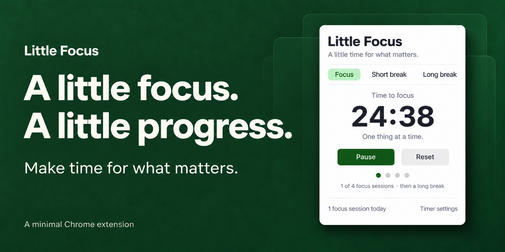

# Little Focus

**A little time for what matters.**

A simple Pomodoro timer for Chrome. Pick one thing, start your focus, take a break. Styled to match [Tabs](https://github.com/nickdc8/tab-manager) and [Little List](https://github.com/nickdc8/little-list): white surfaces, system type, soft green accents, and a comfortable 440px popup.

## Features

- **Focus:** 25 minutes. **Short break:** 5 minutes. **Long break:** 15 minutes.
- A long break is offered after every four completed focus sessions.
- Start, pause, resume, or reset. Breaks and new focus sessions start when you choose.
- Custom durations from 1–120 whole minutes.
- A toolbar badge shows remaining minutes; in the final minute it shows seconds at the badge's next refresh. Paused timers show **Ⅱ**, completed timers **✓**.
- Desktop notifications when a focus or break ends.
- Four progress dots and a count of today's completed focus sessions.
- Open in a separate tab if you prefer to keep the timer visible.
- Works offline; no account or server required.

## Install

1. [Download the ZIP](https://github.com/nickdc8/little-focus/archive/refs/heads/main.zip) and extract it, or clone:

   ```sh
   git clone https://github.com/nickdc8/little-focus.git
   ```

2. Open `chrome://extensions` in desktop Chrome and enable **Developer mode**.
3. Click **Load unpacked** and choose the `little-focus` folder containing `manifest.json`.
4. Pin **Little Focus** in the extensions menu, then click its toolbar icon.

No dependencies or build step. Keep the folder in place. After pulling updates, click **Reload** on the extension's card. Requires Chrome 120 or later.

## How the timer works

The running timer stores an absolute finish time in `chrome.storage.local`. Closing the popup or suspending Chrome's service worker does not restart the countdown. Chrome alarms wake the worker for completion and refresh the toolbar badge about every 30 seconds while running. The open popup updates its countdown four times a second using the saved finish time, so a delayed render does not accumulate drift.

Timers recover on Chrome startup. If a deadline passed while Chrome was closed or your computer was asleep, the session completes when Chrome next handles the timer. Only that one session is counted; the next break or focus waits for you to start it. The app cannot notify you while Chrome is closed or wake a sleeping computer. Chrome can delay alarm delivery, so it is not a precision alarm. See [Chrome's alarms documentation](https://developer.chrome.com/docs/extensions/reference/api/alarms).

Enable Chrome notifications in your operating system and disable Do Not Disturb if you want desktop alerts. Notification delivery and sounds follow your system's settings; this extension does not play a separate audio alarm. The completion message remains in the popup if a notification is blocked.

Resetting before completion gives no session credit. Completed focuses count toward the four-session cycle; breaks do not. The daily total uses the computer's local date and attributes a completed focus to its deadline's date. The four-session cycle continues across days. Reset the current timer before changing modes or durations.

## Privacy

Permissions are limited to **storage**, **alarms**, and **notifications**. The app cannot read your browsing history, Gmail, or web page contents. It contains no analytics, remote scripts, external fonts, or application server. Timer state and settings stay in the current Chrome profile; running timers do not sync across computers.

## Development and checks

```sh
npm test
```

No dependency installation needed. Tests use Node's built-in test runner and mocked Chrome/DOM APIs. They cover deadlines, pause/resume, completion, four-session cycles, midnight, settings validation, failure recovery, notification deduplication, alarm restoration, serialized controls, and popup interactions.

To preview the UI without installing, serve this folder with a static server and open `popup.html`:

```sh
python3 -m http.server 4318 --bind 127.0.0.1
```

The web preview uses separate local storage and labels itself **preview only**. It has no extension alarms or desktop notifications, and completes timers when the preview is open again. Extension browser QA and real system notification delivery have not been verified in this session; earlier browser preview permissions were declined.

## Artwork

The [README banner](docs/images/hero.png) matches the other extensions. Generated with the built-in image-generation tool; [prompt](design/hero-prompt.txt). A 1280 × 640 [GitHub share image](docs/images/social-preview.png) is included.

GitHub's social preview is configured separately from the README. In [repository settings](https://github.com/nickdc8/little-focus/settings), choose **Social preview → Edit → Upload an image** and select `docs/images/social-preview.png`. It has not been attached automatically because browser access to GitHub settings was previously declined.

## License

[MIT](LICENSE)
